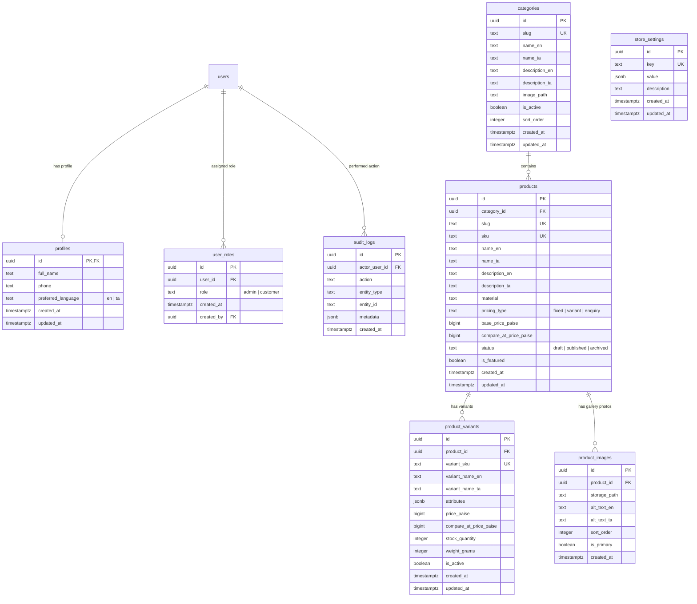

# Vaagai Metals Traders — Database Architecture & Migrations

> PostgreSQL database schema, Row Level Security (RLS) policies, and storage configurations for Vaagai Metals Traders, managed through version-controlled Supabase SQL migrations.

---

## 1. Database Architecture & Schema Overview

The database is built on PostgreSQL with Row Level Security (RLS) enabled on all tables. Prices and monetary values are strictly represented in integer paise (`BIGINT`) to prevent floating-point rounding inaccuracies.



---

## 2. Migration Files

Migrations are located in `supabase/migrations/` and executed sequentially:

1. **`20261122000001_phase2b_enums_and_functions.sql`**:
   - Enables `uuid-ossp` and `pgcrypto` extensions.
   - Defines `handle_updated_at()` trigger function for maintaining `updated_at` columns.
2. **`20261122000002_phase2b_create_tables.sql`**:
   - Creates the 8 core tables with foreign keys, constraints, and performance indexes.
   - Sets up automatic profile and customer role creation on `auth.users` insert.
3. **`20261122000003_phase2b_security_and_rls.sql`**:
   - Defines `public.is_admin()` helper function with `SECURITY DEFINER` and safe `search_path`.
   - Enables RLS on all 8 tables and configures granular security policies.
   - Configures explicit SQL grants for `anon` and `authenticated` roles.
4. **`20261122000004_phase2b_storage_bucket.sql`**:
   - Provisions `product-images` storage bucket (5 MB limit, allowed MIME types: JPG, PNG, WebP).
   - Enforces storage RLS: public read for all visitors; upload, update, and delete restricted to administrators.
5. **`20261122000005_phase2b_seed_data.sql`**:
   - Inserts the 8 genuine Vaagai categories (Pooja Items, Brassware, Silverware, Cast Iron, Aluminium Products, Traditional Lamps, Kitchen Accessories, Decor & Gifts).
   - Inserts baseline store profile and delivery configurations.

---

## 3. Row Level Security (RLS) & Access Rules

| Table | Anonymous Visitors | Authenticated Customers | Administrators (`is_admin()`) |
| :--- | :--- | :--- | :--- |
| **`categories`** | Read (`is_active = true`) | Read (`is_active = true`) | Full CRUD |
| **`products`** | Read (`status = 'published'`) | Read (`status = 'published'`) | Full CRUD (including draft & archived) |
| **`product_variants`** | Read (published product & active) | Read (published product & active) | Full CRUD |
| **`product_images`** | Read (published product images) | Read (published product images) | Full CRUD |
| **`profiles`** | No access | Read & update own profile | Read & update any profile |
| **`user_roles`** | No access | Read own role | Read & assign roles (customers cannot self-promote) |
| **`store_settings`**| Read all | Read all | Full CRUD |
| **`audit_logs`** | No access | Append only (trigger/system) | Read all (no edit or delete allowed for anyone) |

---

## 4. Storage Configuration

- **Bucket ID:** `product-images`
- **Visibility:** Public (`public = true`)
- **Max File Size:** 5 MB (`5242880` bytes)
- **Allowed MIME Types:** `image/jpeg`, `image/png`, `image/webp`
- **File Organization Convention:**
  ```text
  product-images/
  └── products/
      └── {product_slug}/
          ├── primary.webp
          ├── gallery-1.webp
          └── gallery-2.webp
  ```

---

## 5. Migration Execution & CLI Workflow

### Local Development
```bash
# Start local Supabase container (requires Docker)
npx supabase start

# Apply migrations locally
npx supabase db reset
```

### Linking to Remote Supabase Project
To link your CLI to the remote project (`paxqrnvwifqxltyjrsoi`):

```bash
# 1. Login to Supabase CLI with your personal access token
npx supabase login

# 2. Link repository to remote project
npx supabase link --project-ref paxqrnvwifqxltyjrsoi

# 3. Push migrations to remote database
npx supabase db push
```

*Note: Alternatively, migrations can be applied directly using Supabase's migration pipeline or the SQL Editor in one click.*

---

## 6. Administrator Provisioning Procedure (For Phase 2C)

Actual administrator accounts are not hardcoded in migrations. When the two administrators create their accounts in Phase 2C:

1. The administrator signs up via Supabase Auth (or is invited via dashboard/API).
2. Look up their UUID in `auth.users`:
   ```sql
   SELECT id, email FROM auth.users WHERE email = 'admin@vaagaimetals.com';
   ```
3. Assign the administrator role:
   ```sql
   INSERT INTO public.user_roles (user_id, role)
   VALUES ('<USER-UUID>', 'admin')
   ON CONFLICT (user_id, role) DO NOTHING;
   ```
4. Verification:
   ```sql
   SELECT public.is_admin(); -- returns true when logged in as that admin
   ```

---

## 7. Safe Database Reset Procedure

For local or staging environments:
```bash
# Safely reapplies all migrations and seed files from scratch
npx supabase db reset
```
Never run destructive drop commands in production. Production updates must always be incremental, reversible forward migrations.
